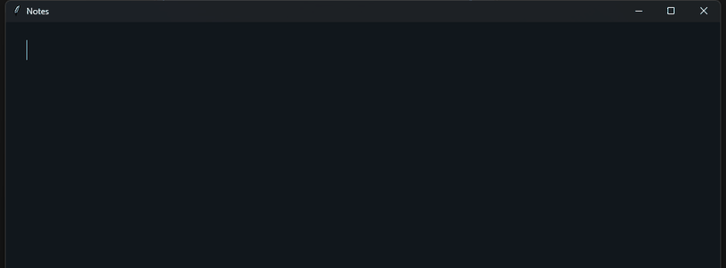

<p align="center">
  
</p>

<h1 align="center">Snipt</h1>

<p align="center">
  <b>A tiny Win+V-style popup for <i>your own</i> snippets: text, templates and links.</b><br>
  Press a shortcut, type a few letters, hit Enter, and the snippet is pasted where you were typing.
</p>

<p align="center">
  
  
  
  
  
</p>

<p align="center">
  
</p>

<p align="center">
  <br>
  <sub>Shortcut, a few letters, Enter: the snippet lands where you were typing</sub>
</p>

- **~350 KB** single `.exe`. No installer, no runtime, no web view. Download it and run it.
- **~2.5 MB** private memory while running, and no CPU at all while it waits in the tray.
- Pure Rust + Win32 + GDI, with a single dependency (`windows-sys`, plain API bindings). Icons come from the Segoe Fluent Icons font built into Windows.

## Install

1. Download `snipt.exe` from the **Releases** page of this repository.
2. Put it in a permanent folder, for example `%LOCALAPPDATA%\Programs\Snipt\`.
3. Double-click it. A tray icon appears, and you can open Snipt with **`Ctrl+Shift+Space`**.

On first run Snipt creates its folder, `%APPDATA%\Snipt`, with `snippets.txt` and a few examples. Two more small files appear there when they're needed: `usage.txt` after your first paste, and `settings.txt` if you change the shortcut.

That's it. Nothing else to install: the exe is fully standalone (the C runtime is linked in, so the Visual C++ Redistributable isn't needed).

**Requirements:** Windows 10 or 11, 64-bit. Snipt runs as your normal user and needs no admin rights.

**"Windows protected your PC"?** The exe isn't code-signed (certificates cost money, and this is a free tool), so Microsoft SmartScreen warns about it the first time you run a new download. Click **More info**, then **Run anyway**. If you prefer not to trust a prebuilt binary, [build it yourself](#build) from source; it takes about a minute.

### Start with Windows

Right-click the tray icon and check **Start with Windows**. Snipt then starts quietly in the tray each time you sign in. This uses your user's `Run` registry key, so no admin rights are needed, and you can also turn it off in Task Manager > Startup apps. If you later move `snipt.exe` to another folder, just run it once from the new place and the startup entry follows it.

<p align="center">
  <br>
  <sub>The tray menu</sub>
</p>

### Uninstall

1. Uncheck **Start with Windows** in the tray menu (if you turned it on), then choose **Exit**.
2. Delete `snipt.exe`.
3. Optionally delete `%APPDATA%\Snipt` (your snippets, usage counts and settings).

Snipt leaves nothing else behind.

## Usage

| Key | Action |
|---|---|
| `Ctrl+Shift+Space` | Open Snipt (the default; [choose your own](#changing-the-shortcut)) |
| type | Fuzzy search by name, or text inside the snippet |
| `↑` `↓` `Tab` `PgUp` `PgDn` | Navigate |
| `Enter` / click | Paste into the app you were using |
| `Shift+Enter` | Open a link in the browser instead of pasting it |
| `Ctrl+E` | Edit the selected snippet |
| `Ctrl+N` | New snippet (what you typed in the search becomes its title) |
| `Ctrl+P` | Pin or unpin the selected snippet |
| `Esc` | Clear the search, press again to close |

### What comes first

With an empty search the list shows **pinned** snippets first (in file order), then the ones you **use most**, then the rest. While you search, pinned matches stay on top, the best match comes next, and usage only breaks ties.

"Use most" means recently, too: each paste counts 1 and the count halves every week, so this week's favourites beat last month's. The counts live in `usage.txt`, which is safe to delete if you want to start over.

### Managing snippets

Click the **gear** in the bottom-right corner to switch to manage mode:

- **Enter** or a click edits a snippet, and **+ New** creates one.
- **Del** or the trash icon deletes a snippet after an inline confirmation.
- **Ctrl+P** or the pin icon pins or unpins it.
- **Esc** or the gear goes back to normal mode.

<div align="center">
  <table>
    <tr>
      <td align="center" valign="top">
        <br>
        <sub>Manage mode: pin, edit or delete the selected snippet</sub>
      </td>
      <td align="center" valign="top">
        <br>
        <sub>Deleting asks first, right in the row</sub>
      </td>
    </tr>
  </table>
</div>

The editor has a title, a type (URL, Template or Text) and the content. Template placeholders can be inserted with one click. URLs are validated before saving. The **Pin** toggle next to the type keeps the snippet at the top. Shortcuts in the editor: `Ctrl+Enter` saves, `Tab` switches fields, `Ctrl+T` changes the type, `Ctrl+P` pins, and `Esc` cancels. The editor stays open if you switch to another app, so you can copy text in from elsewhere.

<p align="center">
  <br>
  <sub>The editor, with one-click template placeholders</sub>
</p>

The tray icon menu has **Manage snippets**, **Open snippets file**, **Change shortcut...**, **Start with Windows** and **Exit**.

### Changing the shortcut

Right-click the tray icon, choose **Change shortcut...**, and press the combination you want, for example `Ctrl+Alt+S`. It's saved right away and works everywhere from then on. If another app or Windows already uses it, Snipt tells you so you can pick another. Use Ctrl, Alt or Win with a letter, number or other key; F-keys also work on their own. **Reset to default** goes back to `Ctrl+Shift+Space`.

The choice is stored in `%APPDATA%\Snipt\settings.txt` as `hotkey = Ctrl+Alt+S`. If it's taken by another app the next time Snipt starts, Snipt falls back to `Ctrl+Shift+Space` and shows a notification.

If `Ctrl+Shift+Space` itself is already used by another app, Snipt falls back to `Ctrl+Alt+V`, then `Win+Shift+V`. The tray icon's tooltip always shows the shortcut in use.

## Snippets file

Everything is stored in `%APPDATA%\Snipt\snippets.txt`, a plain text file that's easy to back up or sync with git, and fine to edit by hand:

```text
@ GitHub profile [url]
https://github.com/you

@ Email sign-off [pin]
Best regards,
{cursor}
```

- Each `@ Name` line starts a snippet. The optional tag `[url]`, `[text]` or `[template]` sets its type; without it, Snipt detects the type.
- Add `pin` to keep a snippet at the top: `[pin]`, or together with a type, `[url, pin]`.
- Variables: `{date}`, `{time}`, `{datetime}`, `{clipboard}` and `{cursor}` (where the cursor ends up after pasting).

## How it works

1. `RegisterHotKey` handles the global shortcut, and Snipt remembers which window had focus. While **Change shortcut** is open, a low-level keyboard hook sees keys before any other app's shortcut, so Snipt can tell you when a combination is taken (and Win combinations don't open Start). The hook is removed as soon as that screen closes.
2. A borderless popup opens at the text cursor (or the mouse pointer) on the right monitor. Its height fits the number of snippets, it gets dark mode and rounded corners from DWM, and it is drawn double-buffered with GDI. Every clickable area is recorded while painting, so clicks always match what's on screen.
3. On Enter, Snipt gives focus back to that window, puts the snippet on the clipboard, sends `Ctrl+V` with `SendInput`, and moves the cursor for `{cursor}`.
4. 500 ms later your previous clipboard text is restored. Snippets are marked with `ExcludeClipboardContentFromMonitorProcessing`, so they don't fill up your Win+V history.
5. The editor uses native `EDIT` controls, styled dark, so undo, selection, IME and paste work as usual.
6. Animations (fade/slide on open and close, gliding selection, height changes, hover and delete-confirm fades) are short eased tweens driven by one timer. The timer runs only while something moves (~100 ms), so idle CPU stays at zero. They follow the Windows "Animation effects" setting. Pasting is never delayed: focus goes back to your app first, then the popup fades out on its own.
7. The search caret blinks at your Windows cursor blink rate (solid while you type) and repaints only its own pixels, about two tiny repaints a second while the popup is open.

## Build

```bash
cargo build --release
```

You need [Rust](https://rustup.rs) with the default MSVC toolchain (it asks to install the Visual Studio Build Tools if they're missing).

The binary is `target/release/snipt.exe`. The release profile is tuned for size (`opt-level = "z"`, LTO, `panic = "abort"`, stripped), and `.cargo/config.toml` links the C runtime statically (`+crt-static`), so the exe only depends on DLLs that ship with Windows. `build.rs` embeds `assets/snipt.ico` as the exe's icon without any build tools or extra crates; to redesign the icon, edit and run `assets/make_icon.ps1`.

### Publishing a release

1. Bump `version` in `Cargo.toml`, then run `cargo build --release`.
2. On GitHub, create a release with a tag like `v0.1.0`.
3. Attach `target/release/snipt.exe` to the release.
4. Optionally, include its SHA-256 hash so people can check the download. You get it with `certutil -hashfile target\release\snipt.exe SHA256`.

## Known limitations

- Windows blocks pasting into apps running as administrator unless Snipt also runs as administrator.
- Only plain text is restored to the clipboard after pasting. If you had copied an image or rich text, the snippet stays on the clipboard instead.
- Saving from the editor rewrites the file and drops `[url]`/`[template]` tags where Snipt would detect the same type anyway. Comments at the top of the file are kept.
